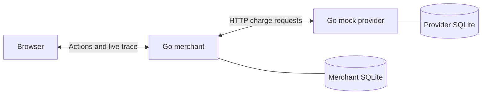

# Schrödinger’s Charge

A mock payment provider records a ₹499 charge, then the merchant times out. Reconcile the payment and see why a retry creates only one charge.

[**Try the live demo → charge.hitanshu.xyz**](https://charge.hitanshu.xyz/)

1. Choose **Response times out after commit** and click **Pay ₹499**. The merchant shows pending. The provider already has one charge.
2. Click **Reconcile**. The merchant marks it paid. The charge count stays at one.
3. Click **Reset**, choose **Request fails before commit**, and click **Pay ₹499**. Then click **Race two retries** to see one insert and one replay.

## Architecture



The merchant saves a pending record before sending a charge. Reconciliation looks up the charge and retries only when the provider returns HTTP 404. Every retry uses the same payment ID, which is the primary key in the provider’s database.

## Run locally

Use Go 1.22 or later.

```sh
mkdir -p bin
go build -o bin/ ./cmd/provider ./cmd/merchant
bash ./scripts/demo.sh
```

Open [localhost:10000](http://localhost:10000). The demo runs both Go processes and uses a separate SQLite database for each.
