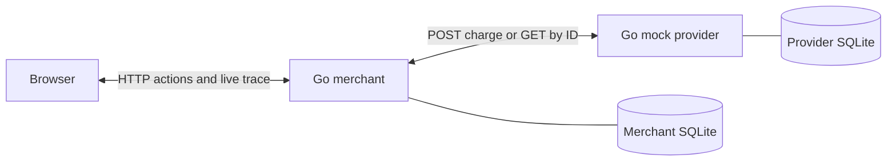

# Schrödinger’s Charge

A fault injection project about payment recovery. A merchant sends a ₹499 charge and times out after the provider records it. The merchant must recover the outcome without charging the same payment twice.

[**Live demo · charge.hitanshu.xyz**](https://charge.hitanshu.xyz/)

## The failure

The merchant saves the payment as `pending` before it sends `POST /charges`. In the timeout scenario, the mock provider commits the charge and delays its reply by 2 seconds. The merchant gives up after 500 ms.

At that point, the merchant has a pending payment and the provider has one charge. A timeout can also happen before the provider writes a charge. The demo models that outcome by returning HTTP 503 before the insert. Recovery checks the provider’s record to distinguish the two outcomes.

## Architecture



| Component | Implementation |
| --- | --- |
| Merchant | Go with `net/http` and `database/sql`. Stores the payment ID, amount in paise, and status. Exposes a CLI and a web UI. |
| Mock provider | Separate Go HTTP process. Owns the charge ledger in its own SQLite file. Both Go processes use the `modernc.org/sqlite` driver. |
| Browser | HTML, CSS, and vanilla JavaScript. Reads newline-delimited JSON from the merchant to animate the request flow and show the final database state. |
| Hosting | One Render Web Service runs both processes. The provider listens on localhost. The hosted demo uses temporary SQLite files. |

## Recovery and duplicate prevention

`reconcile` reads pending payments from SQLite. For each payment, the merchant sends `GET /charges/{id}`.

| Lookup result | Merchant action |
| --- | --- |
| `200` with the same ID and amount | Mark the local payment `paid`. |
| `404` | Retry `POST /charges` with the original ID and amount. Mark it paid after confirmation. |
| Timeout, other error, or mismatched charge | Keep the payment pending for a later reconciliation. |

A lookup and a retry are separate requests. Two workers can both see a `404` before either retry reaches the provider. The provider handles that race at the write. It uses `payment_id` as its primary key and inserts with `ON CONFLICT (payment_id) DO NOTHING`. One request inserts the charge and receives `201`. A retry with the same amount receives the existing charge with `200`. Reusing the ID with a different amount returns `409`. [Provider ledger](cmd/provider/ledger.go)

## Verification

- The recovery test starts a fresh merchant process after the timeout. Reconciliation marks the payment paid, and the provider still has one charge for 49,900 paise. It also verifies that a failed lookup leaves the payment pending and only a missing charge triggers a retry. [Recovery test](cmd/provider/recovery_test.go)
- The concurrency test runs 24 attempts against two connections to the same SQLite file. It checks for one insert, 23 replays, and a final total of 49,900 paise. [Concurrency test](cmd/provider/ledger_test.go)

## Run locally

Use Go 1.22 or later.

```sh
mkdir -p bin
go build -o bin/ ./cmd/provider ./cmd/merchant
bash ./scripts/demo.sh
```

Open [localhost:10000](http://localhost:10000). Run `go test -race ./...` to run the recovery and concurrency tests.
